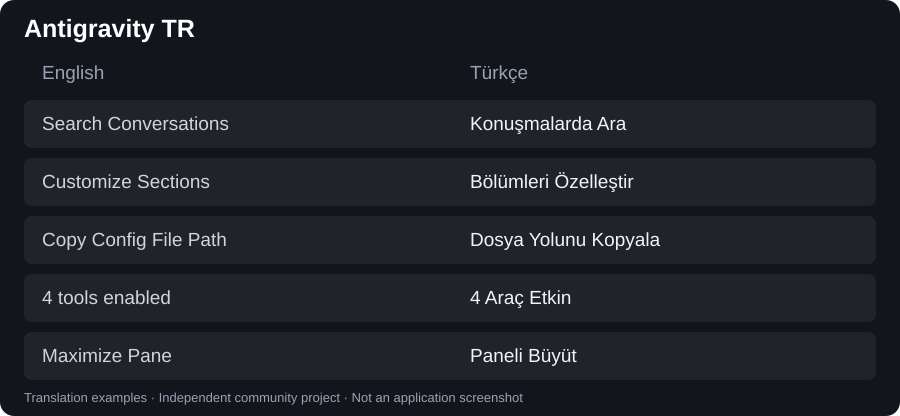

# 🇹🇷 Google Antigravity & Antigravity IDE Türkçe Dil Paketi
### Independent Turkish localization for Google Antigravity on Windows

<div align="center">

[](LICENSE)
[](https://antigravity.google)
[](test/)
[](#kurulum)
[](https://github.com/foztrk/antigravity-tr)

[⭐ **Yıldız Ver (Star)**](https://github.com/foztrk/antigravity-tr) •
[💬 **Geri Bildirim / Hata Bildir**](https://github.com/foztrk/antigravity-tr/issues) •
[📥 **Sürümler (Releases)**](https://github.com/foztrk/antigravity-tr/releases)

</div>

---

> [!TIP]
> 🌟 **Bu projeyi faydalı bulduysanız ve Antigravity'yi Türkçe kullanmaktan memnunsanız, sağ üst köşeden projeye bir Yıldız (Star ⭐) vererek destek olabilirsiniz!**
> Projeye yıldız vermeniz, çalışmanın ve Türkçe arayüz talebinin görünürlüğüne katkı sağlar.

Google Antigravity Desktop ve Antigravity IDE için topluluk tarafından geliştirilen kapsamlı Türkçe yerelleştirme araçları. Google'ın resmi ürünü veya resmi dil paketi değildir.

Mevcut IDE çevirileri, ayar sözlükleri ve Türkçe asistan kuralları korunmuştur. **1.0.17 sürümü; Desktop ayarları, beceri ve MCP açıklamaları, yerel sağ tık menüleri ve alt menü çevirilerini genişletir. Eklenti adları korunur.**


## English overview

Antigravity TR is an independent, open-source Turkish UI patch maintained by [Faruk Öztürk (@foztrk)](https://github.com/foztrk). It translates recognized interface labels in Antigravity Desktop on Windows, including menus, settings, permission dialogs, review panels, and dynamic status messages.

**Current release: v1.0.17 · Desktop 2.23.1 · 42 automated tests.** The installer backs up the application archive and supports restoration. Tests cover translation behavior, repeated installation, and preservation of controls and user content. They do not establish complete visual coverage of every screen.

This project is **not affiliated with or endorsed by Google**. It modifies local application resources and needs compatibility checks after updates. The latest release validates Desktop; the retained IDE installer has a separate, broader scope described below.

## İndir / Download

[**Download the latest Windows patch / Son Windows yamasını indir**](https://github.com/foztrk/antigravity-tr/releases/latest)

Open the latest release and download the named patch ZIP plus its SHA256SUMS file. Extract the ZIP, install Node.js 22.12 or later with npm, close Antigravity, and run `install.ps1`. Turkish installation and rollback instructions follow below.

Son sürüm sayfasından yama ZIP’ini indirin; GitHub’ın otomatik kaynak ZIP’iyle karıştırmayın. SHA256SUMS dosyası indirme bütünlüğünü kontrol etmek içindir.

## Çeviri örnekleri / Translation examples



Bu görsel gerçek uygulama ekran görüntüsü değil, sözlükteki çevirilerden hazırlanmış bir karşılaştırmadır. / This is a comparison of translation entries, not an application screenshot.

## Katkı ve iletişim / Contribute & contact

- **Users:** report missing labels with the Desktop version and a screenshot in [Issues](https://github.com/foztrk/antigravity-tr/issues). Hide account details and private conversation content.
- **Contributors:** see [CONTRIBUTING.md](CONTRIBUTING.md) for translation and testing guidance.
- **Antigravity team:** I would welcome guidance on supported localization contributions and would be happy to share translation resources and help test an official Turkish interface. Contact me through a [GitHub issue](https://github.com/foztrk/antigravity-tr/issues) or my [profile](https://github.com/foztrk).

## Doğrulanmış kapsam

- Windows, kullanıcı dizinine kurulmuş **Antigravity Desktop 2.17.0, 2.18.1, 2.19.1, 2.21.1, 2.22.0, 2.23.0 ve 2.23.1**.

- Node.js **22.12 veya üstü** ve npm.
- Desktop menüleri, sözlükteki düğmeler, ayar metinleri ve araç ipuçları.
- Masaüstü uygulamasının açılması gerçek kullanıcı tarafından doğrulandı.
- DOM çevirisi, tekrar kurulum, arşivdeki diğer dosyaların korunması ve yedekten geri dönüş otomatik testlerle denetlenir.

IDE için mevcut kapsamlı kurucu korunmuştur; bu düzeltmede IDE'ye yeniden yama uygulanmadı. Her ekranın ve her yeni sürümün bütünüyle Türkçe olduğu iddia edilmez. macOS ve Linux bu dağıtımın desteklenen hedefleri değildir. Desktop kurucusu bilinmeyen uygulama sürümüne yazmayı reddeder.

## Kurulum

Kaynak ZIP dosyasını bir klasöre çıkarın. Antigravity pencerelerini kapatın; kurucu çalışan uygulamaya yazmaz.

```powershell
npm ci --ignore-scripts
node bin/antigravity-tr.js install-desktop
```

Alternatif: aynı klasörde `./install.ps1` çalıştırın. Bu seçenek yalnızca Desktop'ı yamalar.

npm üzerinde yayımlanmış bir paket varsayılmaz; `npx antigravity-tr` yerine bu yerel komutları kullanın.

### Eski yamadan sonra siyah ekran

Yalnızca bilinen V2 çeviri döngüsünü düzeltmek için:

```powershell
node bin/antigravity-tr.js repair-desktop
```

Bu komut mevcut çevirileri koruyarak sadece `dist/preload.js` içindeki hatalı koşulu değiştirir.

### IDE ve Desktop kapsamlı kurulum

Önceki projenin IDE dil paketi, özel bileşenler, eklenti açıklamaları ve `GEMINI.md` Türkçe iletişim kurallarını uygulayan komutu:

```powershell
node bin/antigravity-tr.js install
```

Bu geniş kapsamlı komut IDE, Desktop, bazı VS Code eklentileri ve kullanıcı dil ayarlarına da yazar. İki uygulamayı da kapatın. IDE güncellemelerinde mevcut `.bak` yedeklerinin eski sürümden kalabileceğini kontrol edin; geniş kurucu için sürümler arası güvenilirlik henüz doğrulanmadı. Yalnızca Desktop düzeltmesi gerekiyorsa `install-desktop` kullanın.

## Yedekleme ve geri alma

Desktop işlemleri, değiştirmeden önce paket yanında benzersiz `app.asar.backup-...` yedeği oluşturur. Sonuçta yedek yolu yazdırılır. Yeni arşivde tüm dosyaların içeriği doğrulanır; değişiklik kapsamı dışındaki paket içeriği ve paket dışı dosyaların türü korunur. Sohbet verileri yama paketine dahil edilmez.

```powershell
node bin/antigravity-tr.js restore-desktop "C:\...\resources\app.asar.backup-..."
```

Yol verilmezse varsa eski `app.asar.bak`, yoksa en eski yeni yedek seçilir. Geri alma, uygulama sürümü farklıysa veya dosya bütünlüğü doğrulanamazsa durur. Geri alma öncesindeki durum da ayrıca yedeklenir. Eski hatalı yamayı içeren bir yedek seçerseniz siyah ekran geri gelebilir; bu durumda `repair-desktop` kullanılabilir.

`node bin/antigravity-tr.js restore` önceki geniş IDE geri alma akışıdır; eklentiler ve kullanıcı ayarlarının tamamı için birebir durum geri yükleme garantisi verilmez.

## Çeviriye katkı

- Desktop sözlüğü: `scripts/desktop_full_dictionary.json`.
- IDE arayüz kuralları: `locales/tr.json`.
- IDE ayar sözlüğü: `src/settings_dictionary.js`.
- Türkçe asistan yönergeleri: `rules/GEMINI.md`.

Çeviriler yalnızca görünür etiketleri hedeflemelidir; teknik ayar değerlerini, model kimliklerini veya kullanıcı içeriklerini değiştirmeyin. Metin düğümlerindeki eşleşmeler tam metin üzerinden yapılır. Kod/editör alanları ve tanınan mesaj alanları atlanır; yeni arayüz sürümlerinde bu seçicilerin tekrar kontrol edilmesi gerekir.

```powershell
npm ci --ignore-scripts
npm test
```

Testler kurulu Antigravity dosyalarına yazmaz; geçici örnek arşivler ve DOM ortamı kullanır. Ayrıntılar: [CONTRIBUTING.md](CONTRIBUTING.md).

## Dağıtım

GitHub kaynak paketi; yama kaynakları, sözlükler, testler ve belgeleri içerir. Antigravity uygulamasının kendisi, `app.asar`, kullanıcı konuşmaları, `.memory`, yerel deneme çıktıları ve orijinal uygulama bundle'ları dağıtıma dahil edilmez. Yerel geliştirme deposunun eski geçmişini incelemeden doğrudan herkese açık depoya göndermeyin; temiz kaynak paketini kullanın.

Projenin kendi kaynak kodu [MIT](LICENSE) lisanslıdır. Antigravity, Google ve üçüncü taraf bileşenlerinin hakları kendi sahiplerine aittir.

## 1.0.3 — Desktop 2.19.1
Desktop 2.19.1 kurulumu ve yama uygulaması doğrulandı; 14 otomatik test geçti, ana arayüz canlı olarak açıldı. Her alt ekranın yeniden kontrol edildiği iddia edilmez. IDE bu güncellemede yamalanmadı.
